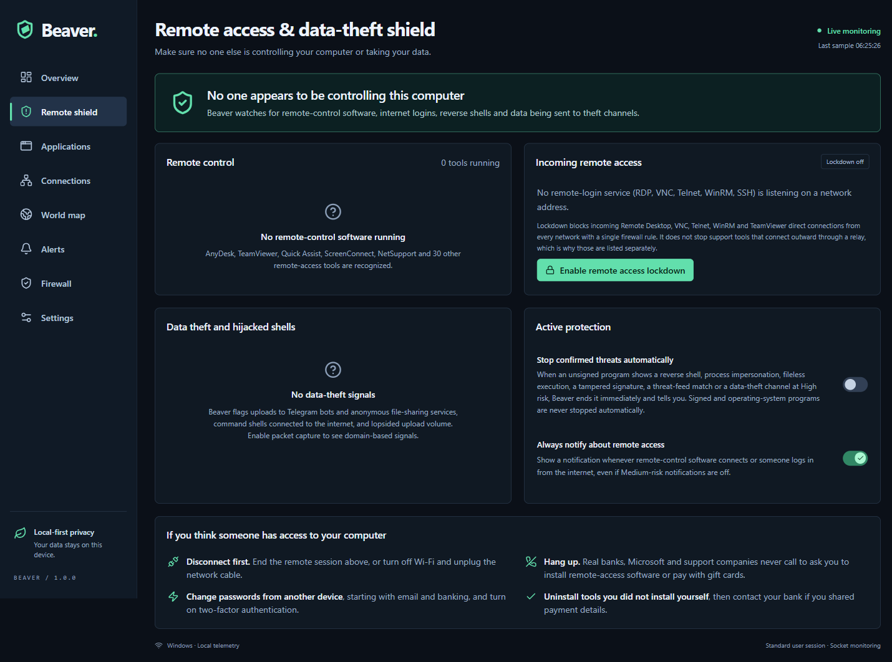

# Beaver

**Know what connects. Stop who shouldn't.**

Beaver is a free, open-source network security monitor for **Windows and Linux**. It shows every application that talks to the network, explains why each one is low or high risk, warns you the moment something dangerous happens, even when the window is closed, and lets you cut it off with native firewall rules.

It is built for people who want to know whether someone is remote-controlling their PC, whether a program is sending their data somewhere it shouldn't, and whether anything is talking to known criminal infrastructure. Everything is analysed **on your device**: no account, no cloud, no telemetry.

[Download the latest release](https://github.com/AmoghShukla06/Beaver/releases/latest) · [How detection works](docs/DETECTION.md) · [Architecture](docs/ARCHITECTURE.md) · [Platform notes](docs/PLATFORMS.md)



---

## What it does

| | |
|---|---|
| **Live network inventory** | Every observable app, its PIDs, remote IPs, domains, ports, protocol state, countries and (with capture) per-app upload/download speed. Read from the real OS socket table every 2 seconds. Website names come from DNS and the TLS handshake, so most HTTPS sites are named even when the browser uses encrypted DNS. |
| **Remote access & data-theft shield** | Detects remote-control tools (AnyDesk, TeamViewer, Quick Assist, ScreenConnect, NetSupport and 35+ more), Remote Desktop/VNC/SSH/WinRM logins **from the internet**, reverse shells, and uploads to infostealer channels (Telegram bots, anonymous file-sharing). One click ends the session; one click locks down incoming remote-access ports. |
| **Threat intelligence** | 225,000+ indicators from six public feeds (abuse.ch Feodo C2, Spamhaus DROP v4/v6, HaGeZi threat domains, Emerging Threats, IPsum), matched entirely locally. Your IPs and domains are never uploaded. |
| **Behavioral detection** | Process masquerading (fake `svchost.exe`), tampered or missing code signatures, living-off-the-land binaries reaching the internet, Office documents spawning scripts, C2 beaconing on a fixed schedule, RAT and Tor ports, fileless and deleted executables on Linux, lopsided upload volume. Every rule is mapped to MITRE ATT&CK. |
| **Explainable risk scores** | Low / Medium / High / Unknown with a 0–100 score. Each point is backed by evidence, a technique link and the legitimate explanation, so you can decide rather than guess. |
| **Instant notifications** | Native Windows/Linux notifications for High risk, remote access and new apps going online, even when Beaver lives in the tray. On Windows, notifications have buttons: *End session*, *Block app*, *Looks fine*. Bursts are coalesced, and notifications can be paused for an hour from the tray. |
| **New-app alerts** | One notification the first time any program reaches the internet, with its publisher and destination. Apps already on the PC are learned silently during the first 10 minutes. |
| **Investigations** | Executable path, Authenticode publisher, SHA-256 (with a one-click VirusTotal lookup that sends only the hash), parent process, first-seen time, live sockets, full connection history and JSON export. |
| **Native firewall control** | Block/unblock apps (Windows) or remote endpoints (Windows + Linux nftables), inbound port lockdown, and allowlists. Rules are verified against the OS firewall. Every change is confirmed by you and authorised by the OS (UAC/polkit). |
| **World map** | Offline political map of where your connections go, with per-country statistics and threat markers. Optional free DB-IP City database, downloaded once and queried locally. |
| **Active protection (opt-in)** | Automatically stops unsigned programs that show a reverse shell, impersonation, fileless execution, tampered signature, threat-feed match or theft channel at High risk. Signed and OS programs are never stopped automatically. |

## Built to run all day

Beaver is designed to stay in the background permanently:

- **~1% of one CPU core** for the monitoring service (under 0.15% of an 8-core machine). The service runs at below-normal priority, so it never competes with your work.
- **About 280 MB total in the tray** (Electron about 233 MB working set plus a 47 MB service). Closing the window unloads the UI completely rather than hiding it, and GPU acceleration is off for this static UI.
- **Push-based alerts**: the service pushes alerts to the tray process; nothing polls while the window is closed. A minimized window stops refreshing.
- **Native packet capture** through libpcap/Npcap with a hand-written header parser: about 25× faster to start than a Scapy-based capture and about 5 MB of overhead. Only the first 128 bytes of a frame are copied, except DNS answers and TLS handshakes.
- **Battery-aware**: with no window open on battery power, sampling slows from 2 s to 4 s.
- **Bounded storage**: incremental SQLite writes, 7-day default retention, hard row caps.

Measured on Windows 11 with 34 network-active apps and ~400 sockets; numbers vary by machine.

## Install

Download from [Releases](https://github.com/AmoghShukla06/Beaver/releases/latest):

| Platform | File |
|---|---|
| Windows 10/11 x64 | `Beaver-Setup-<version>.exe` (installer) |
| Linux x64 (Debian/Ubuntu) | `beaver-security_<version>_amd64.deb` |
| Linux x64 (any distro) | `Beaver-<version>.AppImage` |

Builds are not code-signed yet. Windows SmartScreen may show *"Windows protected your PC"*; choose *More info → Run anyway*. Verify downloads against `SHA256SUMS.txt` on the release page.

**Optional but recommended:**
- **Windows:** install [Npcap](https://npcap.com/) for per-app speeds and domain names from DNS.
- **Linux:** `sudo apt install libpcap0.8 nftables policykit-1`. For per-app speeds without root, see [Linux capture](docs/PLATFORMS.md#linux).

On first launch a short setup asks about starting at sign-in, packet capture and notifications. From v1.1, the Windows installer and AppImage update themselves from GitHub Releases (Settings → *Install updates automatically*).

## Run from source

Requirements: Node.js 22.12+ (24 recommended), Python 3.11–3.13.

```bash
python -m venv .venv
.venv/Scripts/python -m pip install -r requirements.lock   # Linux: .venv/bin/python
npm ci
npm run build
npm start
```

Windows shortcut: `powershell -File scripts/setup.ps1`; Linux: `sh scripts/setup.sh`. Run as a normal user; never run Electron as root or disable its sandbox.

| Command | Purpose |
|---|---|
| `npm run desktop` | Vite dev server + live Electron app |
| `npm test` | Backend test suite (49 tests, including real socket discovery) |
| `npm run test:desktop` | Real Electron end-to-end tests incl. accessibility scans, live feed download, capture and notifications |
| `npm run typecheck` / `npm run build` | TypeScript checks and production UI |
| `npm run package` | Build the bundled service and an installer for the current OS |

## How risk is decided

Scores are transparent prioritization rules, not malware probabilities. The full rule table, with points, ATT&CK techniques and false-positive notes, is in **[docs/DETECTION.md](docs/DETECTION.md)**.

- **High (80–100):** strong evidence, such as a botnet C2 or Spamhaus DROP match, a malicious domain, an internet login to Remote Desktop, or a reverse shell. High alerts always notify.
- **Medium (30–79):** behavior worth reviewing, such as remote-control software connected, a theft channel, process impersonation, a tampered signature or beaconing.
- **Low (0–29):** no strong signals in what is observable. *Low is not a safety guarantee.*
- **Unknown:** not enough identity, observation time or fresh intelligence.

Threat-feed matches are never suppressed by allowlists. A valid publisher signature reduces behavioral points but never threat-intel or remote-access points; abused remote tools are usually signed.

## Privacy

- No accounts, analytics or crash reporting. The service has **no listening port**; the UI talks to it over private stdin/stdout.
- Feed downloads are plain HTTPS GETs and never include your data. A VirusTotal lookup only happens when you click it, and sends only the file hash.
- Local SQLite history with configurable retention (1–30 days). The data folder is shown in Settings.
- Packet capture is opt-in. It reads packet headers, DNS answers and the plaintext server name (SNI) in the TLS handshake. It never reads or stores page contents, and it does not decrypt anything.
- Update checks (on by default, can be turned off) contact GitHub Releases only.

## Limitations

Beaver is a network-behavior monitor, not a full antivirus. It does not scan files for malware signatures or decrypt TLS. With capture on, encrypted-DNS lookups are still named through the TLS server name, except for sites that use Encrypted Client Hello and for QUIC/HTTP-3 connections. Sockets are sampled every 2 seconds, so very short connections can be missed. Linux executable-path blocking is not available in nftables (endpoint and port rules are). See [SECURITY.md](SECURITY.md) for the threat model.

## Contributing

Issues and pull requests are welcome; read [CONTRIBUTING.md](CONTRIBUTING.md). Detection changes need a false-positive explanation and a test.

## License

Apache-2.0. Third-party components and data feeds keep their own licenses; see [THIRD_PARTY_NOTICES.md](THIRD_PARTY_NOTICES.md).
